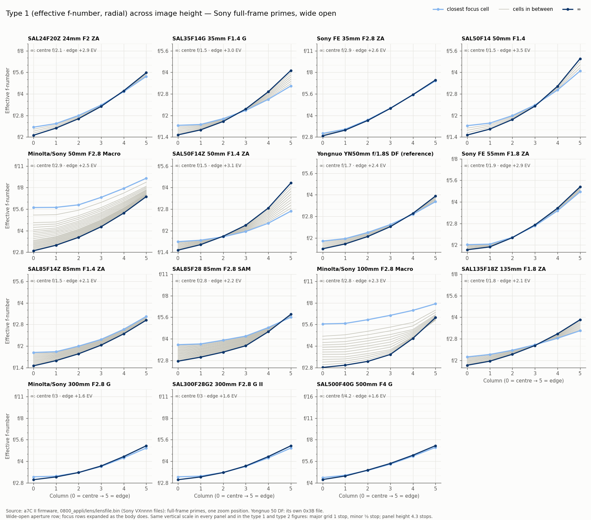
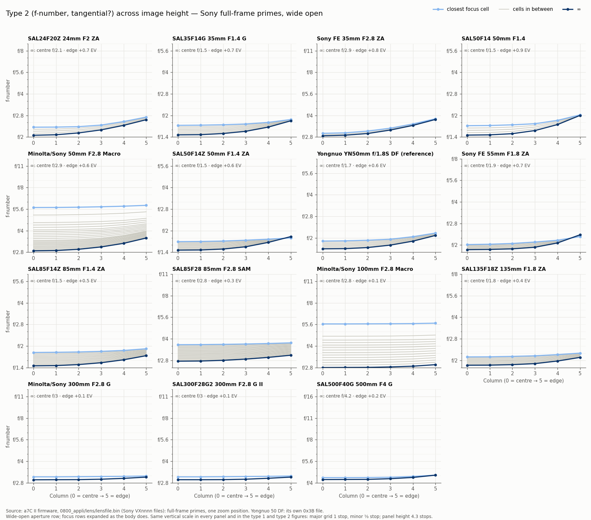
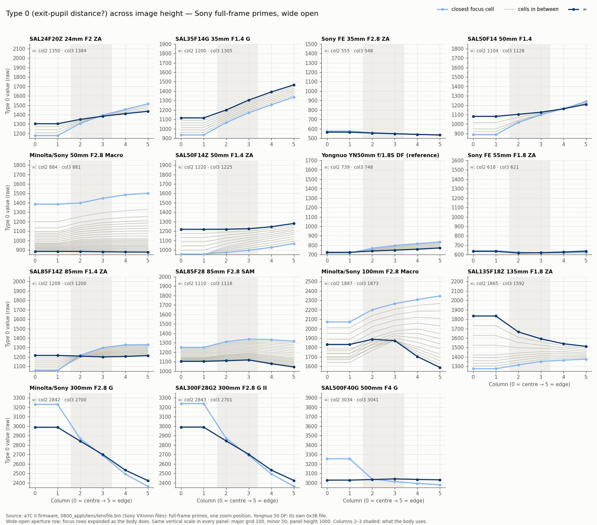

# Message 0x3B — the paged optical file

**Summary.** The lens serves a file of about 2.7 KB, 488 bytes per request, announced beforehand by
[message 0x3A](msg_0x3A.md). It holds tables indexed by aperture, focus distance and zoom, with
values that describe **the exit pupil and vignetting across the image field**. On an a9 II it
decides whether **AF-C and video** can use phase-detect AF ([below](#33-effect-on-the-body)). Never
captured on the wire.

**Direction:** L→B reply to a paged body request, which has not been observed. **Class:** `0x03`.
**Length:** 500 bytes (491-byte payload).

`pl` is the payload: `pl[n]` is payload byte `n`, i.e. absolute frame offset `n + 6`. Ranges
`pl[a..b]` are inclusive of both ends: `pl[a]` through `pl[b]`, length `b - a + 1`.

This page has three parts:

1. [Data structure](#1-data-structure): paging, the file's chunks, the three axes, the table, the
   check word.
2. [Optical meaning](#2-optical-meaning): what types 0, 1 and 2 describe.
3. [How the body uses it](#3-how-the-body-uses-it): what the body reads, what it ignores, and what
   changes when the file is there.

## 1. Data structure

### 1.1 Paging — CERTAIN in Yongnuo and TTArtisan firmware

| Field | Meaning |
| --- | --- |
| request `pl[0]` | page number, 1-based; Yongnuo clamps it to the page count from [0x3A](msg_0x3A.md) |
| request `pl[1]` | echoed into reply `pl[2]` by Yongnuo; `00` in TTArtisan's stored replies |
| reply `pl[0..2]` | `00 <page> <request pl[1]>` |
| reply `pl[3..490]` | the next 488 bytes of the file |

The pages joined in order give the file. Its end is zero-filled. The file is chosen by the preceding
0x3A request.

### 1.2 The file

A 16-byte header followed by chunks and a check word. Every chunk has an 8-byte header: a
2-character tag, a u16 header size (`08 00`), and a u32 LE data length.

| Part | Contents | Confidence |
| --- | --- | --- |
| `LF` header | `4c 46 10 00`, u32 LE length of everything after this header (check word included), u32 version (`0b`, `0d`, `01` seen), u32 model ID (Sony's files carry their part number here, e.g. `0x9101` in `VX9101`) | layout CERTAIN |
| `ED` | **the main table**, [§1.4](#14-the-table-ed) | layout CERTAIN |
| `CS` | **the table's axes**, [§1.3](#13-the-three-axes-cs) | CERTAIN |
| `LC` | 12 bytes, six u16, [§1.5](#15-lc) | partly CERTAIN |
| last 4 bytes | **check word**, [§1.6](#16-the-check-word) | CERTAIN |

Parsers also accept the tags `OE` and `OS` and skip any tag they do not know:

- The A7 IV's parser stops once it has read as far as the `LF` length counts from the start of the
  file, which falls before the check word. CERTAIN on the A7 IV firmware.
- The a7C II parser does the same, in its main application, and treats an `LF` header with a zero
  header size or zero length as an error. CERTAIN on the a7C II firmware.
- The a7C II compares each tag as a u16 LE against `0x454F` and `0x534F`, which are the byte strings
  `OE` and `OS`. The A7 IV's `EO`/`SO` are probably the same two values read in the other byte order.
- An `OE` chunk has the layout of `ED` with two blocks per aperture instead of three (types 0 and 1
  only). What `OE` and `OS` hold is UNKNOWN; no observed file has them.

### 1.3 The three axes (`CS`)

The `CS` header is three u16 counts, `n0`, `Nf` and `Na`, then a fourth u16, then `n0 + Nf + Na`
u16 axis values. Observed files have `01 00 <Nf> 00 <Na> 00 00 00`: `n0 = 1`, and the fourth word
`00 00` is the one value of the `n0` axis, not padding. CERTAIN on the a7C II firmware, which reads
it this way.

Each grid cell is indexed by **zoom × focus × aperture**:

| Axis | Count | Values | Confidence |
| --- | --- | --- | --- |
| zoom (`n0`) | 1 on primes; 30–58 on E-mount zooms | zoom position, 0 to 128 on the zooms | CERTAIN on the a7C II library |
| focus | `Nf`: 8 or 9 on a 50 mm lens, 4 on a 17 mm | increasing, ending in `0x700` | see below |
| aperture | `Na`, about 24 | ⅓-stop steps down from wide open | CERTAIN |

- **Aperture** values run `0x000, 0x055, 0x0ab, 0x100 …`. 256 counts are one stop, the scale of the
  [aperture value](aperture_value.md) without its offset. The last entry (`0xa55`, `0xaaa`) breaks
  the progression and looks like an end marker. **Row 0 is wide open, whatever the lens's maximum
  aperture is**: the a7C II keys this axis by the current aperture minus the maximum aperture
  (CERTAIN on the a7C II firmware), and column 0 of type 1 starts at the lens's own maximum and
  climbs `0x55` per row.
- **Focus** values are [distance codes](autofocus.md#25-the-distance-code). Every Sony E-mount file
  in the [a7C II library](#18-sonys-own-files-the-a7c-ii-library) ends in `1792` (`0x700`, the top of
  that code's range, i.e. ∞), and the E 30 mm Macro's axis starts at 169, which is 0.097 m, that
  lens's minimum focus. CERTAIN for the Sony E-mount files. A-mount files in the same library use a
  one-byte scale that ends at 255. Example, the Yongnuo 50 DF: `312 322 336 356 376 414 478 1792` =
  0.46, 0.51, 0.59, 0.74, 0.92, 1.38 and 2.77 m, then ∞. The steps are nearly even in 1/D, about
  0.3 dioptre each.

### 1.4 The table (`ED`)

**Layout — CERTAIN, it parses all observed files exactly.** An 8-byte header of four u16, then
`Na × 3` blocks:

| Part | Contents |
| --- | --- |
| header | `Nh` = 6 (values per row), then `n0` (`1`), then `Nf`, `Na` — the same counts as `CS` |
| block | u16 `1`, u16 `R` (number of focus rows given), u16 `0` (zoom index), `R` u16 focus indices, the first being `0`; then `R` rows of `Nh` u16 |
| block order | aperture-major: three blocks (types 0, 1, 2) for aperture 0, then three for aperture 1, … |

The block is a general sparse 2-D grid: u16 `nA`, u16 `nB`, then `nA` zoom indices, then `nB` focus
indices, then `nA × nB` rows of `Nh` u16, focus-major. Every observed third-party file has `nA = 1`
with zoom index `0`. CERTAIN on the a7C II firmware.

A row has six values, columns 0–5, which run from the image centre to the edge
([§2](#2-optical-meaning)). The a7C II interpolates type 0 as signed and type 1 as unsigned.

**Focus rows between the given indices are interpolated.** Only some focus indices carry a row. The
missing ones are filled linearly between the two given rows around them, in 1/256 steps, rounded. A
row is therefore exact only at its own index, and a file that gives two rows means a straight ramp
from focus index 0 to `Nf − 1`. CERTAIN on the a7C II firmware, which expands every block this way.
The last given index is always `Nf − 1`, so ∞ has a row of its own. Most files give two rows; the
Yongnuo 35 gives up to four.

### 1.5 `LC`

Six u16:

| Word | Meaning | Confidence |
| --- | --- | --- |
| `LC[0]` | format: `01` full frame, `00` APS-C | CERTAIN: set on every full-frame lens and clear on every APS-C (DT, E) lens in the a7C II library |
| `LC[1]`, `LC[2]` | UNKNOWN | |
| `LC[3]` | **maximum aperture**, in aperture-value counts without the offset. E.g. `0x1CA` on the E 24/1.8 is f/1.86, `0x414` on the E 10-18/4 is f/4.11, `0x113` on the 85/1.4 ZA is f/1.45 | CERTAIN: equals type 1, column 0, at ∞ and wide open, on all 57 library files |
| `LC[4]` | UNKNOWN | |
| `LC[5]` | `0` | |

### 1.6 The check word

The last 4 bytes are **the XOR of every u32 LE word before them, from the `LF` tag on**.

The rule holds for all 57 files in the A7 IV's built-in library, for both TTArtisan 50/1.8 sets and
for the Yongnuo 35. The Yongnuo 50 DF and the TTArtisan 17/1.8 carry a word that does not match. The
Yongnuo 50 DF's word is the TTArtisan 50/1.8 set A's, over different data: it was carried over
unchanged when the table was edited. Bodies do not check it ([§3.1](#31-what-the-body-checks)), but a
lens should still send the right value.

### 1.7 Observed files

Third-party lenses:

| Lens | `LF` version | `Nf` × `Na` | focus rows given | `LC` format | check word |
| --- | --- | --- | --- | --- | --- |
| Yongnuo 50 DF | `0b` | 8 × 24 | 2 | `01` | wrong |
| Yongnuo 35 DA | `0b` | 15 × 24 | 2–4 | `00` | right |
| TTArtisan 50/1.8 — set A | `0b` | 8 × 24 | 2 | `01` | right |
| TTArtisan 50/1.8 — set B | `01` | 9 × 25 | 2–3 | `01` | right |
| TTArtisan 17/1.8 | `0d` | 4 × 24 | 2 | `00` | wrong |

The TTArtisan 50/1.8 picks between its two sets according to the body: one set for some bodies, the
other for the rest, which include the a9 II.

No Sony lens has been seen serving a file. Sony's own files are in the bodies' firmware, below.

### 1.8 Sony's own files: the a7C II library

CERTAIN on the a7C II firmware.

The body carries files for older Sony lenses itself, in `0800_appli/lens/lensfile.bin` (256 KB) of
its firmware package. The A7 IV has a library in the same format (same chunks, version `0b`). The
file holds:

1. a u32 count (57);
2. that many 16-byte names;
3. a u32 size array;
4. a u32 offset array, from the start of `lensfile.bin`.

Each entry is a complete `LF` file named after a Sony part number, for example `VX9101`. The `LF`
model field carries the same number (`0x9101`). Teleconverter combinations have their own files,
named lens + converter, for example `VX89138924`. `VX8924` and `VX8925` are the 1.4× and 2×
converters.

The files cover:

- **18 E-mount lenses**: the E 18-55, 55-210, 18-200 (both versions), PZ 18-200, 30 Macro,
  24/1.8 ZA, 50/1.8 OSS, 16-70 ZA, 10-18, PZ 16-50, PZ 18-105 G, 20/2.8 and 35/1.8 OSS, and the
  FE 35/2.8 ZA, 24-70/4 ZA, 55/1.8 ZA and 28-70. Lens names come from the ExifTool lens tables,
  whose comments give the same part numbers.
- **29 A-mount lenses**, for use on an LA-EA adapter, plus their teleconverter combinations.

How the body picks one is in [§3.4](#34-built-in-files-for-older-lenses).

## 2. Optical meaning

The table describes the light cone that reaches each point of the image: where it comes from (type 0)
and how wide it is (types 1 and 2). The readings below fit every file, but no Sony document
confirms them. Each is marked.

### 2.1 Common to all three types

- **The six columns run from the image centre (column 0) to the edge (column 5).** PROBABLE: the
  values are symmetric at column 0 and change monotonically outward, as an off-axis pupil does.
  Which image heights the columns stand for is UNKNOWN.
- **Types 1 and 2 are f-numbers on a 256-per-stop scale**, the aperture value without its offset.
  CERTAIN for type 1 column 0, which the body uses this way ([§3.2](#32-what-the-body-reads)).
  Column 0 rises by about `0x55` (⅓ stop) per aperture row, and at ∞ wide open it equals the lens's
  maximum aperture `LC[3]` on every Sony file.

The figures below show the wide-open aperture row of every full-frame prime in the
[a7C II library](#18-sonys-own-files-the-a7c-ii-library), plus the Yongnuo 50 DF's own file for
comparison. Each focus cell is one line, interpolated as in [§1.4](#14-the-table-ed): light blue is
the closest focus cell, dark blue is ∞. The vertical scale is the same in every panel; only the
range differs. Types 1 and 2 share one scale (major grid 1 stop, minor ⅓ stop).

### 2.2 Type 1 — effective f-number, radial direction



**Type 1 is the effective f-number at each image height, set by mechanical vignetting off axis.**
CERTAIN that the body reads it as an effective f-number; the vignetting reading is PROBABLE.

- Column 5 is 1.6–3.5 stops higher than column 0 on these primes: about 1.6 on the long lenses,
  about 3 on the fast 24–55 mm. Across the whole library it is 1.5–4.4 stops; the largest values
  are on wide-angle zooms at the wide end (FE 24-70/4 at 24 mm +4.4, E PZ 16-50 at 16 mm +3.9).
- **The outer columns ignore the iris at wide apertures.** They hold a fixed value and only start to
  rise once the aperture is smaller than that value: the lens barrel limits the off-axis beam until
  the iris becomes the smaller stop. TTArtisan 50/1.8, ∞, the first rows (decimal):

  ```
  461  532  638  779  970 1217     wide open
  546  550  638  779  970 1217
  631  635  648  779  970 1217
  717  721  733  779  970 1217     1 stop down
  ```

- On the macro lenses the whole row climbs toward close focus, about 2 stops, as the working
  f-number grows.

### 2.3 Type 2 — f-number, the other direction across the pupil



**Type 2 is the same kind of f-number as type 1, measured across the pupil instead of along the
image radius.** PROBABLE.

Off axis, the barrel cuts the pupil into a "cat's eye": narrow along the radius of the image, nearly
full width across it. Type 1 fits the radial width and type 2 the width across. The a7C II library
(57 files) and the Yongnuo 50 DF show this:

- **Column 0 is the same in both.** In 3679 rows, type 2 equals type 1 in 2445 and is within 3 in
  almost all the rest. On axis the pupil is round, so both widths are equal.
- **Without vignetting the rows are identical.** Of the 219 rows where type 1 is flat across all six
  columns, 205 have the same type 2.
- **Toward the edge, type 2 rises much less**: 0.1–0.9 stop at column 5 on the primes above. FE
  55/1.8 ZA, wide open, ∞, rise from column 0:

  | column | 1 | 2 | 3 | 4 | 5 |
  | --- | --- | --- | --- | --- | --- |
  | type 1 | +34 | +144 | +295 | +494 | +747 |
  | type 2 | +3 | +10 | +29 | +80 | +177 |

- **Stopping down moves type 2 but not type 1.** FE 55/1.8 ZA, closest focus, column 5, in ⅓-stop
  steps from wide open: type 1 is 1144, 1144, 1144, 1137; type 2 is 613, 676, 759, 846. The barrel
  sets the radial width, and the iris still sets the width across.
- **A simple model fits one lens.** Take two equal circles offset by `d`. The radial width is
  `2r − d` and the width across is `2√(r² − d²/4)`, which only changes to second order. On the
  Yongnuo 50 DF, wide open at ∞, the model takes `d` from type 1 and predicts type 2 rises of 2, 12,
  35, 77, 146. The file has 2, 15, 44, 91, 159. On the Sony files the ratio of measured to predicted
  ranges from about 0.4 to 10. Real lenses cut the pupil with two different openings, so only the
  pattern carries over, not the numbers.
- **Exceptions.** In 562 rows (15 %), type 2 rises more than type 1 at some column, by a median of
  14 counts and at most 259. 444 of these rows are in teleconverter files. They are not explained.
- Like type 1, it climbs toward close focus on the macro lenses.

### 2.4 Type 0 — exit-pupil distance



**Type 0 is PROBABLY the exit-pupil distance at each image height.** The unit is UNKNOWN; 0.1 mm
gives plausible distances (POSSIBLE).

- **It barely changes with aperture**, as a pupil position should.
- **It grows with focal length.** Columns 2–3 at ∞, wide open: about 510 on the E 10-18 mm, 550–1220
  on the 35–55 mm primes, 945 on the E 50 mm F1.8, 1110–1890 on 85–135 mm, 1500 on the E 55-210 mm
  at 210 mm, 2700–3040 on 300–500 mm.
- **With focus it moves either way**: up toward close focus on the 50 mm Macro, which focuses by
  moving the whole optical unit, and down on the SAL50F14 and 135 mm.
- Columns 0 and 1 are always equal.
- The body uses it to choose between phase-detect pixel sets built for different exit-pupil
  distances ([§3.2](#32-what-the-body-reads)), which is the main support for this reading.

## 3. How the body uses it

CERTAIN on the a7C II firmware, unless marked.

### 3.1 What the body checks

On the A7 IV (CERTAIN on its firmware):

- reply `pl[0] & 0x0f` must be `0`, or the transfer is abandoned;
- reply `pl[1..2]` (u16 LE) must be the page the body is waiting for, or the page is dropped;
- the body copies 488 bytes per page, and from the last page (the count from [0x3A](msg_0x3A.md))
  only the size from 0x3A minus what it already has. That remainder must be 1–488, so the size and
  the page count in 0x3A have to agree.

The only integrity check is the frame's own 16-bit sum. Nothing checks the file as a whole:

- **The check word is not verified.** The A7 IV never reads it: its parser stops before it
  ([§1.2](#12-the-file)). Verified on the A7 IV firmware up to the hand-off to the main processor,
  which is not visible; PROBABLE beyond that. On the a9 II the file tested
  [below](#33-effect-on-the-body) carried a mismatched word and was used.

The A7 IV names this file `EclipseCom` (Eclipse = vignetting).

### 3.2 What the body reads

In short:

| Type | Kept | Traced use |
| --- | --- | --- |
| 0 | all 6 columns | **column 2 or column 3 only** (one of them, by sensor mode): picks the phase-detect pupil setting |
| 1 | all 6 columns | **column 0 only**: the effective aperture |
| 2 | no, dropped while parsing | none |

The other columns of types 0 and 1 are looked up and handed on with the rest, but no use of them has
been traced ([open questions](#open-questions)).

**Storage.** The body expands every block into a dense grid of `n0 × Nf × Na` cells
([§1.4](#14-the-table-ed)). Each cell is 24 bytes: the type 0 row, then the type 1 row, 12 bytes
each, so a row longer than 6 values does not fit. **Type 2 is parsed and dropped**: the body steps
over each type 2 block without storing it. An `OE` chunk is read into the same kind of grid. The
body records which of `ED` and `OE` it has received as two separate flags.

**Lookup.** Each time the body passes lens parameters to its phase-detect library, it looks the grid
up:

- **Aperture:** linear interpolation, in 1/65536 steps, between the two aperture rows around the
  key. The key is the current aperture minus the lens's maximum aperture
  ([§1.3](#13-the-three-axes-cs)). Below row 0 the body uses row 0, and above the last row it uses
  the last row.
- **Focus:** no interpolation at lookup. The body takes the first focus-axis entry greater than its
  focus key, or the last entry. The key is a lens-state value that PROBABLY uses the same
  0–`0x700` distance code as [0x34](msg_0x34.md) mode 3.
- **Zoom (`n0`):** the same first-greater rule, keyed by another lens-state value.

The result is two 6-value arrays, one for type 0 and one for type 1. The body uses them like this:

- **Type 1 is the effective f-number at each column**, on the aperture-value scale without its
  offset. Column 0 plus `0x1000` is passed on as the effective aperture. When the body has no file it
  fills all six with the current aperture, which is what a lens without vignetting would give.
- **Type 0 picks the sensor's phase-detect pupil setting.** The body takes column 2 or column 3 of
  type 0 (which one depends on the sensor mode) and compares it with a per-body calibration table to
  choose one of several pupil indices. It also passes the value on together with `0x80000 / value`.
  Choosing among several pupil settings matches sensors whose phase-detect pixels come in sets
  designed for different exit-pupil distances ([§2.4](#24-type-0--exit-pupil-distance)).
- **Type 2** is not stored, so it plays no part. The a7C II's phase-detect pixels split the pupil
  left and right. A sensor that splits it in the other direction would need the width across
  ([§2.3](#23-type-2--f-number-the-other-direction-across-the-pupil)), which may be why the file
  carries type 2. That use is POSSIBLE.

### 3.3 Effect on the body

Tested on a **Sony a9 II**, with a device that serves 0x3A/0x3B and asserts both in
[message 0x01](msg_0x01.md):

- **with** 0x3A/0x3B, **AF-C and video use phase-detect AF**;
- **without** them, those modes get no phase-detect AF;
- **AF-S is not affected** either way.

**CERTAIN** on the a9 II; other bodies not tested.

### 3.4 Built-in files for older lenses

At attach the a7C II maps the lens ID to a file name in its
[library](#18-sonys-own-files-the-a7c-ii-library) through two tables: 18 E-mount IDs
(`0x8011`–`0x802D`) and 29 A-mount IDs plus their teleconverter combinations. A lens on the list is
not asked for its file. Lenses released later are not on the list.

## Manufacturer notes

- **Yongnuo** — the 50 DF stores the file bare and cuts it into pages at send time. It also stores
  one ready-built page, which is the `08` object of [0x3A](msg_0x3A.md). The 35 DA stores its file as
  ready-built 500-byte pages. Both lenses assert 0x3B in [message 0x01](msg_0x01.md).
- **TTArtisan** — stores ready-built pages. The 50/1.8 carries two sets selected by body, the 17/1.8
  carries one, and both assert 0x3B.

## Open questions

- Which other bodies depend on it, and what AF-S uses instead. No captured lens asserts 0x3A/0x3B,
  so no capture could show the request.
- Which image heights the columns stand for; the units of type 0.
- `LC[1]`, `LC[2]` and `LC[4]`; what the `OE` and `OS` chunks hold.
- The scales of the A-mount files' focus and zoom axes.
- What the phase-detect side does with the other four type-0 columns and five type-1 columns.
  The lookup keeps all twelve values, but only the uses above have been traced.
- Why the a7C II drops type 2, and whether other bodies use it.
- Why type 2 rises more than type 1 in some rows, mostly in teleconverter files.
