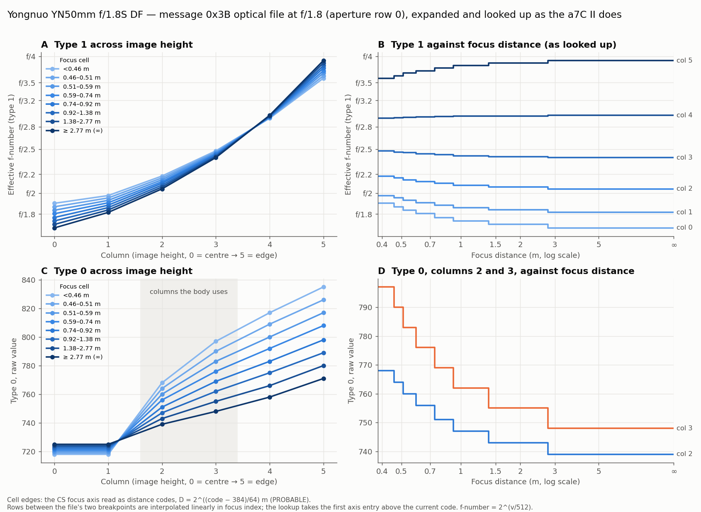

# Message 0x3B — the paged optical file

**Summary.** The lens serves a file of about 2.7 KB, 488 bytes per request, announced beforehand by
[message 0x3A](msg_0x3A.md). It holds a table indexed by aperture and a second axis, with values that
behave like **pupil and vignetting data across the image field**. On an a9 II it decides whether
**AF-C and video** can use phase-detect AF — [below](#effect-on-the-body). Never captured on the wire.

**Direction:** L→B reply to a paged body request, which has not been observed. **Class:** `0x03`.
**Length:** 500 bytes (491-byte payload).

`pl` is the payload: `pl[n]` is payload byte `n`, i.e. absolute frame offset `n + 6`. Ranges
`pl[a..b]` are inclusive of both ends: `pl[a]` through `pl[b]`, length `b - a + 1`.

## Paging — CERTAIN in Yongnuo and TTArtisan firmware

| Field | Meaning |
| --- | --- |
| request `pl[0]` | page number, 1-based; Yongnuo clamps it to the page count from [0x3A](msg_0x3A.md) |
| request `pl[1]` | echoed into reply `pl[2]` by Yongnuo; `00` in TTArtisan's stored replies |
| reply `pl[0..2]` | `00 <page> <request pl[1]>` |
| reply `pl[3..490]` | the next 488 bytes of the file |

The pages joined in order give the file. Its end is zero-filled. The file is chosen by the preceding
0x3A request.

### What the body checks — CERTAIN on the A7 IV firmware

- reply `pl[0] & 0x0f` must be `0`, or the transfer is abandoned;
- reply `pl[1..2]` (u16 LE) must be the page the body is waiting for, or the page is dropped;
- the body copies 488 bytes per page, and from the last page (the count from [0x3A](msg_0x3A.md))
  only the size from 0x3A minus what it already has. That remainder must be 1–488, so the size and
  the page count in 0x3A have to agree.

The only integrity check is the frame's own 16-bit sum. Nothing checks the file as a whole.

The A7 IV names this file `EclipseCom` (Eclipse = vignetting), which supports the reading
[below](#the-table-ed).

## The file

A 16-byte header followed by three chunks and a check word. Every chunk has an 8-byte header: a
2-character tag, a u16 header size (`08 00`), and a u32 LE data length.

| Part | Contents | Confidence |
| --- | --- | --- |
| `LF` header | `4c 46 10 00`, u32 LE length of everything after this header (check word included), u32 version (`0b`, `0d`, `01` seen), u32 model ID (PROBABLE: Sony's own files carry `0x8900`, `0x8901` … here) | layout CERTAIN |
| `ED` | **the main table**, [below](#the-table-ed) | layout CERTAIN |
| `CS` | **the table's axes** — header `01 00 <Nf> 00 <Na> 00 00 00`, then `Nf` u16, then `Na` u16 | CERTAIN |
| `LC` | 12 bytes: u16 `01` on full-frame lenses / `00` on APS-C, then four u16 UNKNOWN | format flag PROBABLE |
| last 4 bytes | **check word**: the XOR of every u32 LE word before it, from the `LF` tag on | CERTAIN, [below](#the-check-word) |

The A7 IV's parser also accepts the tags `EO` and `SO`, and skips any tag it does not know. It stops
once it has read as far as the `LF` length counts from the start of the file, which falls before the
check word. CERTAIN on the A7 IV firmware. The a7C II parser does the same, in its main application,
and treats an `LF` header with a zero header size or zero length as an error. It compares each tag
as a u16 LE against `0x454F` and `0x534F`, which are the byte strings `OE` and `OS`; the A7 IV's
`EO`/`SO` are probably the same two values read in the other byte order.

### The check word

The XOR rule holds for all 57 files in the A7 IV's built-in lens library, for both TTArtisan 50/1.8
sets and for the Yongnuo 35. The Yongnuo 50 DF and the TTArtisan 17/1.8 carry a word that does not
match. The Yongnuo 50 DF's word is the TTArtisan 50/1.8 set A's, over different data: it was carried
over unchanged when the table was edited.

**The body does not verify it.** The A7 IV never reads it (above). On the a9 II the file tested
[below](#effect-on-the-body) carried a mismatched word and was used. Verified on the A7 IV firmware
up to the hand-off to the main processor, which is not visible; PROBABLE beyond that. A lens should
still send the right value; a later body may check it.

### The two axes (`CS`)

- **`Na` aperture steps, in ⅓ stop**: `0x000, 0x055, 0x0ab, 0x100 …`. 256 counts are one stop, the
  scale of the [aperture value](aperture_value.md) without its offset. The last entry (`0xa55`,
  `0xaaa`) breaks the progression and looks like an end marker.
- **`Nf` values of a second axis**, increasing, always ending in `0x700`. A 50 mm lens has 8 or 9 of
  them and a 17 mm lens has 4, so the axis is **probably focus position**. That is POSSIBLE.

The body reads the header as three counts, `n0` (the `1`), `Nf` and `Na`, followed by `n0 + Nf +
Na` axis values. The fourth header word, `00 00`, is therefore the one value of the `n0` axis, not
padding. CERTAIN on the a7C II firmware.

**The aperture axis counts stops down from wide open.** The body's key for it is the current
aperture minus the lens's maximum aperture, in aperture-value counts. Row 0 is wide open whatever
the lens's maximum is. CERTAIN on the a7C II firmware. This fits the files: column 0 of type 1 starts
at the lens's own maximum aperture and climbs `0x55` per row.

### The table (`ED`)

**Layout — CERTAIN, it parses all five files exactly.** An 8-byte header of four u16, then `Na × 3`
blocks:

| Part | Contents |
| --- | --- |
| header | `Nh` = 6 (values per row), then `1`, then `Nf`, `Na` — the same `Nf` and `Na` as `CS` |
| block | u16 `1`, u16 `R` (number of focus segments), u16 `0`, u16 `0`, `R − 1` u16 focus breakpoints, then `R` rows of `Nh` u16 |
| block order | aperture-major: three blocks (types 0, 1, 2) for aperture 0, then three for aperture 1, … |

The body reads a block as a general sparse 2-D grid: u16 `nA`, u16 `nB`, then `nA` indices on
the header's second dimension (the `1`), then `nB` focus indices, then `nA × nB` rows of `Nh` u16,
focus-major. Every observed file has `nA = 1` with index `0`, which is the `1, R, 0, 0, …` layout
above; the focus indices are `0` followed by the `R − 1` breakpoints. CERTAIN on the a7C II
firmware.

**Between breakpoints the body interpolates.** It expands every block into a dense grid of
`Na × Nf × (header 1)` cells and fills the focus indices between two given rows linearly, in 1/256
steps, rounded. A row is therefore exact only at its own breakpoint, and a two-segment file means a
straight ramp from focus index 0 to `Nf − 1`. CERTAIN on the a7C II firmware. The last segment always
starts at `Nf − 1`, so the end of the focus axis (`0x700`) has a row of its own. Most files use two
segments. The Yongnuo 35 uses up to four.

What the a7C II keeps — CERTAIN on the a7C II firmware:

- Each grid cell is 24 bytes: the type 0 row, then the type 1 row, 12 bytes each. A row longer than
  6 values does not fit.
- Type 0 is interpolated as signed, type 1 as unsigned.
- **Type 2 is parsed and dropped.** The body steps over each type 2 block without storing it.
- An `OE` chunk is read the same way with only two blocks per aperture (types 0 and 1). The body
  records which of `ED` and `OE` it has received as two separate flags.

**Meaning — POSSIBLE.** The readings below fit every file, but the columns have not been tied to
anything:

- **Types 1 and 2 are the two edges of the pupil, and the six columns run from the image centre to
  the edge.** In column 0 the two types agree to within 1 in three of the five files, and nearly
  everywhere in the other two (to within 3 in 95 % and 88 % of rows). They separate after column 0.
  That is what the pupil does: it is symmetric on axis and loses symmetry off axis. The a7C II
  drops type 2, though, and reads type 1 as an effective f-number
  ([below](#what-the-body-computes-from-it--certain-on-the-a7c-ii-firmware-unless-marked)).
- **Type 1 shows mechanical vignetting.** Its outer columns hold a fixed value at wide apertures and
  only start to rise once the aperture is smaller than that value. The lens barrel limits the off-axis
  beam until the iris becomes the smaller stop. Type 2 rises slowly toward the edge, or not at all.
- **The values are f-numbers on a 256-per-stop scale.** Column 0 rises by about `0x55` (⅓ stop) per
  aperture row. At the `0x700` end it reads about 461 on f/1.8 lenses, which is f/1.85 on that scale.
  The other focus segment reads higher (573, about f/2.2), the way the working f-number grows at close
  focus.
- **Type 0 barely changes with aperture.** It may be the exit-pupil position.

TTArtisan 50/1.8, type 1, `0x700` end, the first rows (decimal):

```
461  532  638  779  970 1217     wide open
546  550  638  779  970 1217
631  635  648  779  970 1217
717  721  733  779  970 1217     1 stop down
```

If this reading holds, the file is the per-lens pupil data that on-sensor PDAF needs away from the
frame centre.

### What the body computes from it — CERTAIN on the a7C II firmware, unless marked

Each time the body passes lens parameters to its phase-detect library, it looks the grid up as
follows.

- **Aperture:** linear interpolation, in 1/65536 steps, between the two aperture rows around the
  key. The key is the stop-down amount described above. Below row 0 the body uses row 0, and above
  the last row it uses the last row.
- **Focus:** no interpolation at lookup. The body takes the first focus-axis entry greater than its
  focus key, or the last entry. The key is a lens-state value that PROBABLY uses the same 0–`0x700`
  distance code as [0x34](msg_0x34.md) mode 3.
- **`n0` axis:** the same first-greater rule, keyed by another lens-state value, probably focal
  length (POSSIBLE).

The result is two 6-value arrays, one for type 0 and one for type 1. The body uses them like this:

- **Type 1 is the effective f-number at each column**, on the aperture-value scale without its
  offset. Column 0 plus `0x1000` is passed on as the effective aperture. When the body has no file it
  fills all six with the current aperture, which is what a lens without vignetting would give.
- **Type 0 picks the sensor's phase-detect pupil setting.** The body takes column 2 or column 3 of
  type 0 (which one depends on the sensor mode) and compares it with a per-body calibration table to
  choose one of several pupil indices. It also passes the value on together with `0x80000 / value`.
  Choosing among several pupil settings matches sensors whose phase-detect pixels come in sets
  designed for different exit-pupil distances. So type 0 is PROBABLY an exit-pupil distance per image
  height, which agrees with "barely changes with aperture" above.
- **Type 2** is not stored, so it plays no part.

### Example: Yongnuo 50 DF at f/1.8



This is the wide-open aperture row of the Yongnuo 50 DF file, expanded and looked up the way the
a7C II does it ([above](#what-the-body-computes-from-it--certain-on-the-a7c-ii-firmware-unless-marked)).
The file gives two rows per type, at focus index 0 and at index 7; the body interpolates the six in
between.

- **Focus axis.** The axis is `312 322 336 356 376 414 478 1792`. Read as
  [distance codes](autofocus.md#25-the-distance-code), the edges are 0.46, 0.51, 0.59, 0.74, 0.92,
  1.38 and 2.77 m, then ∞; `0x700` is the top of that code's range. In 1/D the steps are nearly even, about 0.3 dioptre each, so the cells are
  spaced evenly in focus extension. The cell from 2.77 m to ∞ is about 0.9 mm of extension, the
  same as the others. Reading the axis as distance codes is PROBABLE.
- **Type 1.**
  - Column 0 is f/1.90 at the near end and f/1.68 at ∞.
  - Column 5 is f/3.58 at the near end and f/3.92 at ∞.
  - All focus rows cross near f/2.95 at column 4.
  - The ∞ value at column 0 is brighter than the lens's f/1.8 marking.
- **Type 0.**
  - Columns 0 and 1 stay near 720 at every focus distance. The value rises from column 2 outward.
  - Columns 2 and 3, the ones the body uses, fall with distance: from 768 to 739 and from 797 to
    748.
  - The units are UNKNOWN.

## Effect on the body

Tested on a **Sony a9 II**, with a device that serves 0x3A/0x3B and asserts both in
[message 0x01](msg_0x01.md):

- **with** 0x3A/0x3B, **AF-C and video use phase-detect AF**;
- **without** them, those modes get no phase-detect AF;
- **AF-S is not affected** either way.

**CERTAIN** on the a9 II; other bodies not tested.

## Observed files

| Lens | `LF` version | `Nf` × `Na` | focus segments | `LC` format | check word |
| --- | --- | --- | --- | --- | --- |
| Yongnuo 50 DF | `0b` | 8 × 24 | 2 | `01` | wrong |
| Yongnuo 35 DA | `0b` | 15 × 24 | 2–4 | `00` | right |
| TTArtisan 50/1.8 — set A | `0b` | 8 × 24 | 2 | `01` | right |
| TTArtisan 50/1.8 — set B | `01` | 9 × 25 | 2–3 | `01` | right |
| TTArtisan 17/1.8 | `0d` | 4 × 24 | 2 | `00` | wrong |

The TTArtisan 50/1.8 picks between its two sets according to the body: one set for some bodies, the
other for the rest, which include the a9 II.

These are all third-party lenses. The A7 IV's built-in library holds Sony's own files in the same
format (same chunks, version `0b`), but no Sony lens has been seen serving one.

## Manufacturer notes

- **Yongnuo** — the 50 DF stores the file bare and cuts it into pages at send time. It also stores
  one ready-built page, which is the `08` object of [0x3A](msg_0x3A.md). The 35 DA stores its file as
  ready-built 500-byte pages. Both lenses assert 0x3B in [message 0x01](msg_0x01.md).
- **TTArtisan** — stores ready-built pages. The 50/1.8 carries two sets selected by body, the 17/1.8
  carries one, and both assert 0x3B.

## Open questions

- Which other bodies depend on it, and what AF-S uses instead. No captured lens asserts 0x3A/0x3B,
  so no capture could show the request.
- Whether the columns are image heights, and which ones; the units of type 0.
- The `1` in the `ED` header. It is a third grid dimension to the body, probably focal length, and
  the two zero words in each block are its index list.
- The `LC` values; what the `OE` and `OS` chunks hold.
- What the phase-detect side does with the other four type-0 columns and five type-1 columns.
  The lookup keeps all twelve values, but only the uses above have been traced.
- Why the a7C II drops type 2, and whether other bodies use it.
